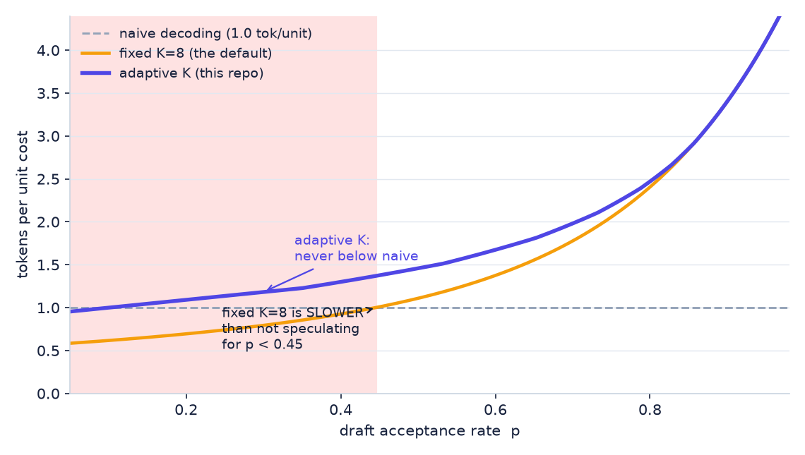
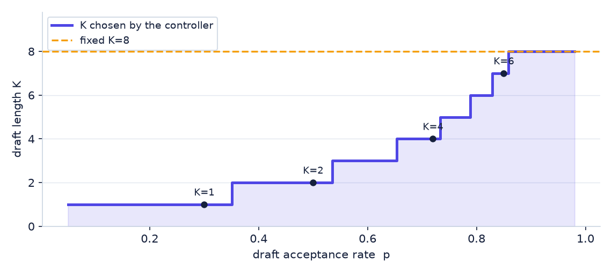
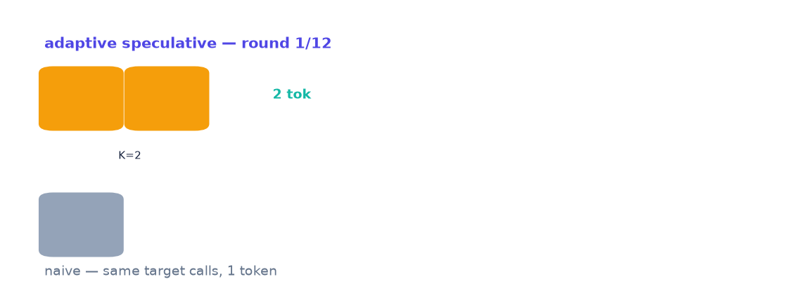

# sdecode


Speculative decoding ships a draft length someone chose once, on a machine that
isn't yours. `sdecode` measures the acceptance rate you're actually getting and
re-answers the question every round — with a closed form, not a search.

**[Open the live session runner →](app/session.html)** — three decoders on one
target-call budget, streaming round by round, with a cost ledger in $/Mtok.
**[Open the tuner →](app/tuner.html)** — drag your measured acceptance and
drafter cost, watch the answer move. Same math as
`sdecode.core.optimal_draft_len`, ported line-for-line; both apps and the
receipt run on one deterministic sim (`app/sim.js`).

---

## The default is a bet, and it can lose to doing nothing

A drafter proposes K tokens, the target model verifies them in one pass, the
matching prefix survives. Everyone ships K=8. But the value of K=8 depends on
your acceptance rate — and below about **p ≈ 0.45**, hard-coded K=8 returns
*fewer tokens per unit cost than simply not speculating*:



That shaded region isn't a slowdown you tolerate; it's the default losing to
naive decoding. At p=0.3 the receipt measures K=8 at **0.794 tok/unit** while
not speculating gives 1.0. The adaptive line never dips below the floor — it
answers K=1 there and takes the win.

## What the controller decides

One argmax over integers, fed by an 8-round window of observed acceptance.
No training, no bandit, no tuning knob — the objective is closed-form:

```
E(K, p) = (1 − p^(K+1)) / (1 − p)        expected accepted run
gain     = E(K, p) / (1 + c·K)            c = drafter/target cost ratio
K*       = argmax over integer K ∈ [1, 8]
```



## One session, watched

Twelve rounds through a toy LM where the drafter tracks the target closely but
not perfectly. Green chips are accepted draft tokens, amber are rejected. Same
target-model calls on both lanes:



## Receipts

`python demos/demo.py` writes `receipts/receipt.json` — every number below
comes from it, measured, reproducible:

| acceptance p | controller picks | adaptive tok/unit | fixed K=8 | adaptive vs K=8 |
|---|---|---|---|---|
| 0.30 | K=1 | 1.182 | 0.794 | **+48.9%** |
| 0.50 | K=2 | 1.458 | 1.109 | **+31.5%** |
| 0.70 | K=4 | 1.981 | 1.777 | **+11.5%** |
| 0.80 | K=6 | 2.470 | 2.405 | +2.7% |
| 0.90 | K=8 | 3.403 | 3.403 | +0.0% |
| 0.95 | K=8 | 4.108 | 4.108 | +0.0% |

At p=0.8, c=0.1: **2.47 tokens per target-model call** against naive's 1.0 —
and the same sweep shows the adaptive choice never trailing the best fixed
candidate from {2, 4, 8} (it ties where the fixed set already contains the
optimum, and picks values the set can't express).

## The ledger, not the plot

`node app/session_receipt.js` runs the session sim across a q-sweep, averaged
over 50 sessions, and writes `receipts/session.json`. Cost is units per token
(1 target call + c per drafter call), steady state = last 30 rounds with the
controller's warm-up flushed:

| acceptance q | naive | fixed K=8 | adaptive | story |
|---|---|---|---|---|
| 0.30 | 1.00 | **0.80** | **1.19** | the default loses to not speculating; controller takes +19% over naive |
| 0.50 | 1.00 | 1.08 | **1.41** | +30% over the default |
| 0.70 | 1.00 | 1.74 | **1.90** | +9% |
| 0.85 | 1.00 | 2.84 | 2.78 | parity — here the default is already optimal, controller converges to it |
| 0.95 | 1.00 | 4.12 | 4.08 | K→8, tracks the default exactly |

And when acceptance isn't stationary — q steps 0.30 → 0.90 mid-session — mean
draft length goes **1.46 → 6.67, settling at K=8**, with the post-drift steady
state beating fixed K=8 (which burned 8-draft rounds through the low regime).

**The ledger found two real bugs the unit tests passed**: `greedy_verify`
dropped the target's bonus token on fully-accepted rounds (one token short
per round while the closed form counted it — and `observe()` saw K−1 on
rounds where all K drafts verified), and the controller's acceptance estimate
was the raw `accepted/drafted` ratio, which is *biased* for censored rounds —
a full-accept K=4 round is weak evidence of p≈1, not proof. Both now have
regression tests (`test_full_accept_emits_target_bonus_token`,
`test_acceptance_estimate_is_censored_mle`) and the estimate is the
censored-geometric MLE.

## The property everything rests on

A speedup that changes your output distribution isn't a speedup, it's a
quantizer wearing a benchmark's hat. Greedy verification is provably
distribution-identical to the target model, and the suite pins it empirically:
same seed, naive greedy vs speculative, token-for-token equality
(`test_output_identical_to_target_greedy`).

## Try it

```bash
pip install -e ".[dev]"
pytest -q              # 9 tests: formula, controller, bonus token, MLE, identity
python demos/demo.py   # receipt + figures
python demos/make_figures.py
node app/session_receipt.js   # session ledger (receipts/session.json)
```

## Prior art

The acceptance criterion and corrected-distribution sampling are Leviathan et
al. ([arXiv:2211.17192](https://arxiv.org/abs/2211.17192), ICML 2023) and Chen
et al. ([arXiv:2302.01318](https://arxiv.org/abs/2302.01318)). This repo is
built on that; the delta is the adaptive-K controller (with a censored-MLE
acceptance estimate), the break-even analysis against naive decoding, the
session ledger that caught a bonus-token accounting bug in full-accept
rounds, and the measurement apparatus around all of it — the core math was
already complete; making the decision observable, correct, and reproducible
is the work here.
