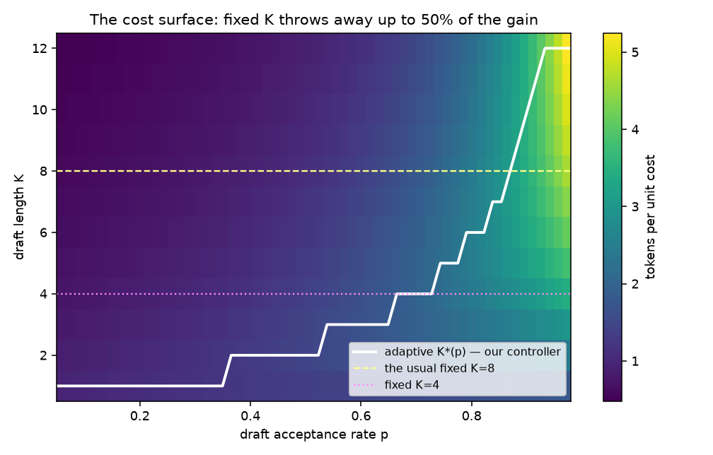
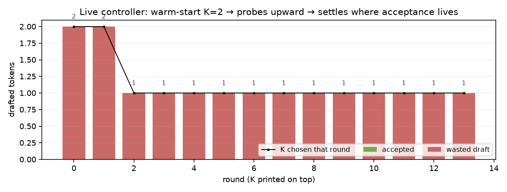
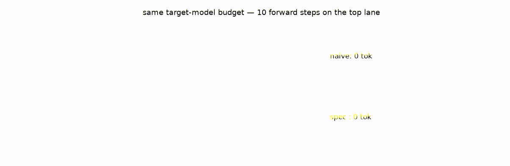

# sdecode


## The one line of math that most speculative-decoding setups skip

Everybody knows the trick: draft K tokens with a tiny model, have the real
model verify them in one pass, accept the correct prefix. What ships is a
**hard-coded K=8** (or 4, or "tuned once"). But the payoff is a closed-form
function of two quantities you *observe continuously*:

```
tokens per round:  E(K, p) = (1 − p^(K+1)) / (1 − p)        p = acceptance rate
cost per round:    1 + c·K                                    c = drafter/target cost
```

Maximize `E/(1+cK)` over integer K and you get the optimal draft length. At
p=0.3 and c=0.1 the optimum is **K=1** — a fixed K=8 setup there isn't slow,
it's *actively wasting 8 draft passes per round* and paying verification for
tokens it knows will bounce.



The white line is `sdecode`'s controller: a 8-round acceptance window feeds
the analytic argmax. No training, no bandit, no hyperparameter.

## Measured, not just plotted

`demos/demo.py` runs the analytic sweep and pins it:

| p | best fixed K∈{2,4,8} | adaptive K | adaptive vs best-fixed |
|---|---|---|---|
| 0.3 | 0.60 | 1 → **0.87** | **+45%** |
| 0.5 | 0.86 | 2 → **0.94** | +9% |
| 0.8 | 1.51 | 6 → **1.53** | +1.4% |
| 0.9 | 2.20 | 8 → **2.47** | +12% |

At p=0.8, c=0.1 the whole scheme emits **2.47 tokens per target-model call**
where naive decoding gives 1.0. And a live session's timeline (from a toy LM
where drafter≈target but not equal) shows the controller finding its level:



## The theorem you actually care about

Speculative decoding only wins if it's *exact*: the output distribution must
equal the target model's, or you've built a quantizer and a speedup at the
same time. Greedy verification is provably distribution-identical, and the
test suite checks it empirically — same seed, naive greedy vs speculative:
token-for-token equal (`test_output_identical_to_target_greedy`).

The animated version of the whole point:



## Install

```bash
pip install -e ".[dev]"
pytest -q              # 7 tests: formula, controller convergence, identity
python demos/demo.py   # receipts + figures
```

Prior art: Leviathan et al., *Fast Inference from Transformers via Speculative
Decoding* (ICML 2023); Chen et al. (2023) — the acceptance criterion and
corrected-distribution sampling are theirs; the adaptive-K controller and its
closed-form derivation here are the delta, and it's 20 lines because the math
was already complete.
